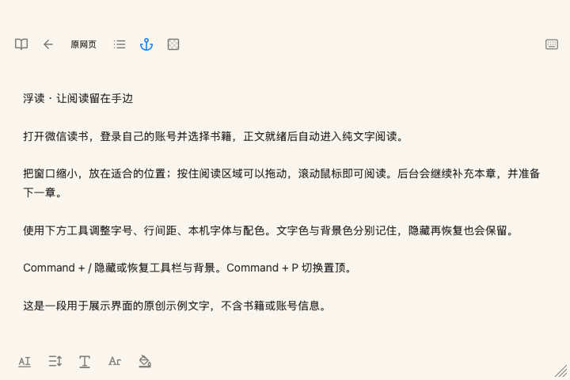

# 浮读 · FloatingReader
一键隐藏工具栏和正文背景，只留下阅读文字。

微信读书悬浮阅读工具。支持窗口置顶、纯文字阅读、后台预读、本机字体、独立配色与自定义快捷键。

**当前为测试版。识别可能出现错字、漏字或重复，重要内容请切回原网页核对。**

[新手教程](docs/新手使用教程.md) · [Windows 说明](docs/WINDOWS.md) · [更新记录](CHANGELOG.md) · [已验证范围](docs/VALIDATION.md)

## 下载与安装

[进入下载页面，查看全部版本](https://github.com/luyalei123-ux/FloatingReader/releases)

请选择与你的电脑对应的安装包：

| 电脑 | 下载链接 |
| --- | --- |
| Intel Mac，macOS 12+ | [下载 Intel 版](https://github.com/luyalei123-ux/FloatingReader/releases/download/v0.26.18/FloatingReader-macOS-Intel-0.26.18.zip) |
| Apple 芯片 Mac，macOS 12+ | [下载 Apple 芯片版](https://github.com/luyalei123-ux/FloatingReader/releases/download/v0.26.18/FloatingReader-macOS-AppleSilicon-0.26.18.zip) |
| Windows 10 22H2／11 x64 | [下载 Windows 测试版](https://github.com/luyalei123-ux/FloatingReader/releases/download/v0.26.18/FloatingReader-Windows-x64-0.29.2-preview.zip) |

当前为公开测试版(如有问题可联系我更新版本)。

macOS：退出旧版，解压，将「浮读.app」放入应用程序文件夹后打开。本次包使用临时签名，未做 Apple 公证，可能出现开发者验证提示。不要关闭系统安全保护。

Windows：完整解压到新文件夹，打开 `FloatingReader.exe`，不要只复制 exe。包内自带 .NET 运行时；仍需 Microsoft Edge WebView2 Runtime 和系统中文 OCR 组件，见 [Windows 使用说明](docs/WINDOWS.md)。

## 开始阅读

1. 在应用中登录自己的微信读书账号，打开有权阅读的书籍。
2. 正文就绪后自动进入纯文字。按钮显示点击后的目标：看文字时显示「原网页」，看网页时显示「纯文字」。
3. 鼠标滚轮阅读，后台补充本章并预读下一章；滚到底请求自动接续，正文底部 ←／→ 可手动换章。
4. 下方工具调整字号、行距、文字色、字体和背景色；右上角键盘图标修改快捷键。
5. 隐藏按钮或快捷键可一起隐藏工具栏、边框和正文背景，文字仍可见。阅读区域可拖动，边缘和四角可缩放；正文不支持文字选择。

首次默认：系统字体、14 pt、1.4 倍行距、文字 `#333333`、背景 `#FBF6ED`。两个颜色独立保存。已有设置保留，可在阅读菜单／右键菜单恢复默认样式。

## 常用快捷键

| 功能 | macOS | Windows |
| --- | --- | --- |
| 显示／隐藏工具栏与背景 | Command+/ | Ctrl+/ |
| 置顶／取消置顶 | Command+P | Ctrl+P |
| 放大／缩小字号 | Command+加号／减号 | Ctrl+加号／减号 |
| 上一章／下一章 | Command+↑／↓ | Ctrl+↑／↓ |
| 纯文字／原网页 | Command+R | Ctrl+R |
| 关闭应用 | Command+Q | Alt+F4 或 Ctrl+Q |

快捷键可修改；输入框保留系统常用编辑操作。后台按固定大页面读取，显示窗口缩小只影响折行。

## 已知限制

- 微信读书网页、画布和字体可能变化；OCR 并不等同于原始电子书文字，不能保证完整、无错或任何书籍都能识别。
- 初次加载、网络、网页绘制、系统 OCR、访问权限会影响预读速度；没有保证零等待。
- 本地保存阅读位置，退出时尝试把位置应用到原网页；是否同步到微信读书云端由网站决定，跨设备一致性尚未完整验证。
- macOS 与 Windows 使用各自的原生窗口和 OCR，实际表现可能不同；置顶不能保证覆盖所有系统界面或独占全屏应用。
- Windows 当前仍是预览版，Apple 芯片包也需实机测试。请在反馈中注明平台、版本、操作与提示。

遇到问题，通过阅读菜单或窗体右键「复制阅读诊断」反馈。请删除书籍标识等私人内容，不要提交 Cookies、账号数据或整份用户配置。[反馈指南](CONTRIBUTING.md)。

## 开源与构建

- [上传 GitHub 与发布下载](docs/UPLOAD_TO_GITHUB.md)
- [本地构建与验证](docs/BUILDING.md)
- [MIT 许可证](LICENSE) · [第三方声明](THIRD_PARTY_NOTICES.md)

本项目与微信读书官方无隶属关系，不提供书籍或账号，不绕过登录、付费或访问限制。请使用自己的合法阅读权限。
